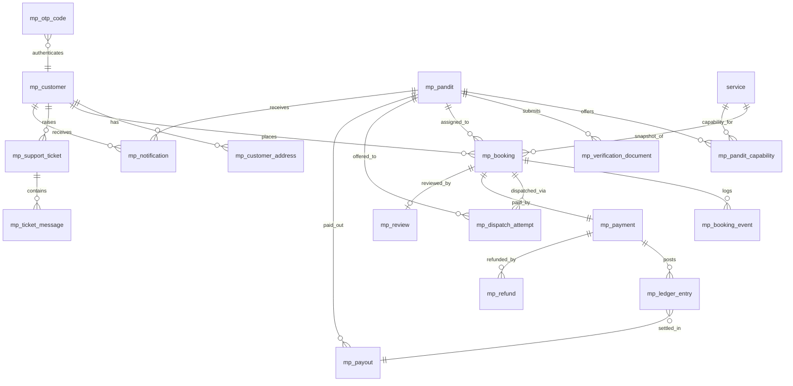

# 09 — Database ERD

**Current:** PostgreSQL/Supabase (prod), SQLite (dev/CI). 31 tables, 8 Alembic
migrations. PostGIS enabled (migration `c3e6a9f1..postgis`). Concurrency invariants +
partial-unique/CHECK constraints added (`a1c4e7d9..concurrency`, `b2d5f8a3..integrity`).

## Entity inventory (verified — 31 tables)
**Identity/content:** `admin_user`, `refresh_token`, `audit_log`, `setting`, `redirect`,
`service`, `category`, `location`, `service_location`, `faq`, `page`, `testimonial`,
`banner`, `homepage_section`, `booking_enquiry`.
**Marketplace:** `mp_customer`, `mp_customer_address`, `mp_pandit`,
`mp_pandit_capability`, `mp_verification_document`, `mp_otp_code`, `mp_booking`,
`mp_booking_event`, `mp_dispatch_attempt`, `mp_payment`, `mp_ledger_entry`,
`mp_refund`, `mp_payout`, `mp_review`, `mp_notification`, `mp_support_ticket`,
`mp_ticket_message`.

## ER diagram (core marketplace)

## Key constraints & integrity (verified)
- **Append-only ledger:** `mp_ledger_entry` — never updated/deleted; entry types
  (customer_charge, gateway_fee, platform_commission, partner_payable, refund, payout).
- **Idempotent webhook:** payment keyed so duplicate webhook posts a single charge set
  (test: `test_webhook_idempotent`).
- **Concurrency invariants:** booking accept uses `SELECT … FOR UPDATE`; partial-unique
  indexes prevent double-active-assignment; refund over-refund guarded by row-lock +
  refresh (`finance.create_refund`).
- **Audit:** `audit_log` append-only, `action` indexed, atomic with its mutation.
- **OTP:** `mp_otp_code` stores keyed hash + `consumed` + `expires_at` + `attempts`.

## Indexes & performance (current + target)
- Present: `ix_audit_log_action`, FK indexes, PostGIS geo index (phase-2). Dispatch
  candidate query uses geo + capability + heartbeat filters.
- **Target [PROPOSED]:** composite indexes on `mp_booking(status, created_at)`,
  `mp_payment(status, created_at)`, `mp_dispatch_attempt(booking_id, outcome)`,
  `mp_notification(recipient, created_at)`; partial index on active bookings.

## Ownership boundaries (which module writes)
Each table is written by exactly one module (see 07). No module writes another's tables
directly except via its service functions — keeps the monolith modular.

## Partitioning strategy [PROPOSED — not yet, needs volume evidence]
High-growth tables to partition **by range(created_at)** when volume warrants:
`mp_booking_event`, `mp_notification`, `audit_log`, `mp_ledger_entry`, tracking/location
history. **Do not partition pre-emptively** (rule: no sharding/partitioning without
measured justification). Add an **outbox** table for external effects.

## Migration strategy
- Alembic, forward-only, reviewed. **Rule:** no destructive migration on prod without a
  backup + restore drill (see 20). Additive columns/indexes preferred; backfills in
  batches; `CREATE INDEX CONCURRENTLY` for large tables (Postgres).
- New entities needed (target): `device_session`, `push_token`, `addon`, `coupon`,
  `invoice`, `bank_account`, `dispute`, `outbox`, `idempotency_key`,
  `tracking_point` (partitioned), `staff_team`/`permission` (if DB-driven RBAC).

## Backup/restore
See [20_BACKUP_AND_DISASTER_RECOVERY](20_BACKUP_AND_DISASTER_RECOVERY.md) — logical dump
script + workflow exist; Supabase PITR + restore drill still to be enabled/run.
