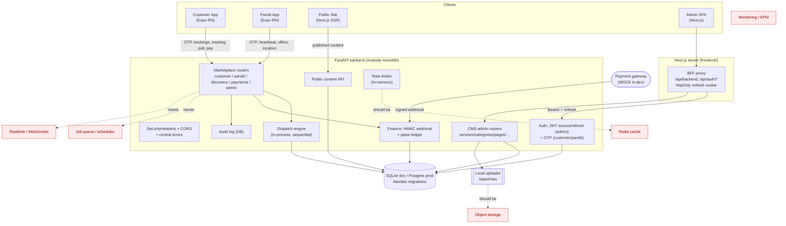

# 02 — Current Architecture

A content-driven service-commerce **modular monolith**: one FastAPI backend serving the public site/CMS and the marketplace, a Next.js admin+site (with a BFF proxy), and two Expo apps. All clients speak HTTP/JSON to the one API; the Next.js BFF additionally holds the admin session cookie.

## Current-state diagram

## Component status

**Implemented**
- Client↔server: REST/JSON; admin via same-origin BFF (token refresh transparent, JWT never in the browser).
- Auth: admin JWT access(15m)+rotating refresh(7d, httpOnly cookie); customer/pandit OTP. Role/status re-read from DB each request.
- Authorization boundaries: object-level scoping (customer/pandit/ticket ownership) + `require_staff(role)` on admin endpoints.
- Error handling: centralized exception handlers, standard error envelope, internals hidden in prod.
- Data access: one transaction-scoped async session per request (commit on success / rollback on error).
- Dispatch + finance + CMS + public content: all functional.
- Migrations (Alembic), security headers (CSP/HSTS), `/health`.

**Partially implemented**
- Scheduled bookings (stored, not dispatched). Offer expiry (lazy, read-triggered). Notifications (records only, no delivery). Media library (backend upload yes; library UI pending).

**Missing**
- Background job queue / scheduler, realtime transport, cache (Redis), object storage, monitoring/APM, CI/CD, containerization.

**Unverified integrations**
- Real payment gateway (only the mock path is exercised). SMS/push providers (none wired). Postgres runtime (psycopg not installed).

## Architectural risks
- **Single DB engine assumption**: logic written against SQLite's single-writer semantics (the accept race is "masked" in dev) — correctness degrades on Postgres without locking. See `05`.
- **In-process state** (rate limiter, dispatch timing) ties the app to a single instance — blocks horizontal scaling. See `09`.
- **Lazy/again read-triggered dispatch progress** — no runner means time-based transitions don't happen autonomously. See `05`.
- **Local filesystem media** — not shareable across instances, no CDN. See `09`/`12`.
