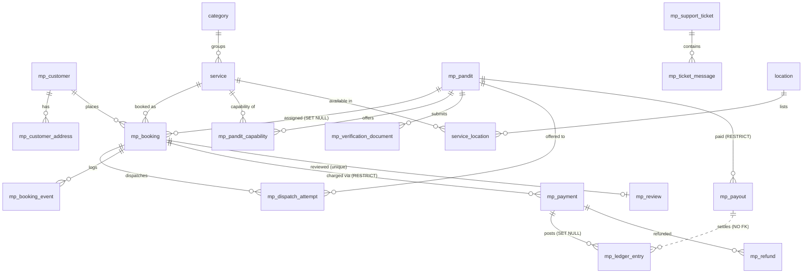

# 04 — Database & Data-Integrity Audit

**ORM:** SQLAlchemy 2 (async, `Mapped`/`mapped_column`). **Dev/test:** SQLite (`aiosqlite`); **prod:** Postgres (`postgresql+psycopg`, normalized in `config.py:68-77`; psycopg **commented out** in `requirements.txt` → prod import would fail until enabled). PKs are UUID everywhere via a portable `GUID` type (`app/db/types.py` → `UUID` on PG, `CHAR(36)` on SQLite). Mixins give `created_at`/`updated_at` and (for content) `status`+`published_at` (`app/db/base.py`). FK enforcement on SQLite is turned on per-connection (`db/session.py:25-31`).

**Schema is migration-driven** (Alembic, 5 linear versions). `create_all` is used **only in tests** (`tests/conftest.py:53`). *(NOT VERIFIED: whether the on-disk `panditji.db` was built by Alembic vs. an earlier `create_all` — `alembic_version` not queried.)*

## A. Table inventory (31 tables)

**Core CMS/identity (`app/models/`)** — 14: `admin_user`, `refresh_token`, `audit_log`, `category`, `service`, `location`, `service_location`, `page`, `faq`, `testimonial`, `homepage_section` (banner.py), `redirect`, `setting`, `booking_enquiry`. All UUID PK + timestamps; content tables add `status`(idx)+`published_at`; slugs/keys unique+indexed; money as integer paise (`service.price_paise`).

**Marketplace (`app/marketplace/models.py`)** — 17:
`mp_customer`, `mp_customer_address`, `mp_pandit`, `mp_pandit_capability`, `mp_verification_document`, `mp_booking`, `mp_dispatch_attempt`, `mp_booking_event`, `mp_payment`, `mp_ledger_entry`, `mp_refund`, `mp_payout`, `mp_review`, `mp_support_ticket`, `mp_ticket_message`, `mp_notification`, `mp_otp_code`.
Highlights: `mp_booking` has `code` unique, FKs customer/service **RESTRICT** + assigned_pandit **SET NULL**, dest lat/lng, `price_paise`, `service_title_snapshot`; `mp_payment` has `provider_order_id`/`provider_payment_id` unique; `mp_review` UniqueConstraint(booking_id); `mp_pandit_capability` UniqueConstraint(pandit_id,service_id).

## B. ER diagram (key relationships)

## C. Missing-relationship / FK report
- **`mp_ledger_entry.payout_id` has NO FK** (`models.py:251`) → orphan payout linkage undetectable at DB level. **Add FK** (RESTRICT).
- **Ledger FKs `booking_id`/`payment_id`/`pandit_id` are `SET NULL`** on an append-only money ledger (`models.py:239-247`) → deleting a booking/payment nulls the financial linkage instead of being prevented. **Change to RESTRICT** (money rows should pin their referents).
- **Polymorphic columns without FK or CHECK**: `mp_notification.recipient_id`+`recipient_kind`, `mp_support_ticket.opener_id`+`opener_kind` — no FK possible, and no `kind` CHECK → cross-type/stale ids undetectable.
- `audit_log.actor_id`/`entity_id`, `mp_otp_code.phone` — intentionally untyped (acceptable).
- **No ORM `relationship()` anywhere** — all joins are manual `select()`. Design choice, not a defect; but no `back_populates` layer.

## D. Data-integrity risk report (ranked)
1. **HIGH — No row locking / no atomic assignment.** `with_for_update` appears only in a comment (`dispatch.py:11`, verified by grep). No unique "one active assignment per booking" constraint. Double-assignment possible on Postgres. (Cross-ref `05` R1.)
2. **HIGH — Status/enum columns are plain strings with no DB CHECK / no DB enum** (`constants.py` holds Python constants). The DB will persist any string; validity is app-only. A bad write/migration can seed invalid states the state machine won't catch.
3. **MEDIUM — `create_order` idempotency is query-based, not a constraint** (`finance.py:64-84`): no unique on an open payment per booking → two concurrent order creations can insert two CREATED payments. (Webhook `record_paid` *is* DB-idempotent via unique provider ids — the solid part.)
4. **MEDIUM — Ledger `SET NULL` + `payout_id` no-FK** (section C) weakens financial referential integrity.
5. **MEDIUM — Polymorphic recipient/opener** have no FK and no kind CHECK (section C).
6. **LOW — Geo / multi-city isolation is app-only**: no `city` scoping column on `mp_booking`; matching is unindexed-float haversine; no DB guarantee of same-city matching.
7. **LOW — Connection pool unsized for Postgres** (`session.py` sets only `pool_pre_ping`); defaults (size 5/overflow 10) likely too small at scale. psycopg not installed.

Positives: integer-paise money everywhere; price/title snapshots on bookings & enquiries (immutable-by-convention); append-only ledger + booking-event tables; HMAC webhook; SQLite FK enforcement explicitly enabled; comprehensive single-column indexing on FKs and hot status columns.

## E. Recommended schema changes (backward-compatible)
1. Add `CHECK` constraints (Postgres) or DB `ENUM` types for `booking.status`, `payment.status`, `availability`, `pandit.status`, `dispatch.outcome`, `ledger.entry_type`.
2. Add a **unique partial index** `mp_booking(id) WHERE status in (assigned states)` enforcement is awkward; instead add a uniqueness guard such as a unique index on `mp_dispatch_attempt(booking_id) WHERE outcome='accepted'` to make "one accepted offer per booking" a DB invariant.
3. Add FK on `mp_ledger_entry.payout_id`; change ledger FKs to `RESTRICT`.
4. Add composite indexes: `mp_dispatch_attempt(booking_id, pandit_id, outcome)` and `(booking_id, outcome)`; `mp_ledger_entry(entry_type, settled, pandit_id)`; `mp_pandit(availability, last_heartbeat)`; `mp_booking(status, scheduled_at)`.
5. Add `recipient_kind`/`opener_kind` CHECK constraints.
6. On Postgres+PostGIS: `geography(Point)` columns + GiST index for `mp_pandit.base`/`live` and `mp_booking.dest`; replace haversine scan with `ST_DWithin`.
7. Optionally add `created_by`/`updated_by` to high-value mutable tables (bookings, pandit, payments) for forensic completeness (finance already has `created_by`).

## F. Backward-compatible migration strategy
- All changes are additive (new constraints/indexes/columns), authored as new Alembic revisions on the existing single-head chain; `render_as_batch=True` already handles SQLite ALTER limitations.
- Before adding CHECK/unique constraints, run a read-only data-validation query to confirm no existing rows violate them (e.g., no duplicate accepted attempts, no invalid status strings); backfill/clean first.
- PostGIS columns: add nullable, backfill from existing lat/lng, then index; keep lat/lng during transition.
- Sequence: (1) clean data → (2) add indexes (non-locking `CREATE INDEX CONCURRENTLY` on PG) → (3) add FK/CHECK/unique with validation → (4) app switch to new query paths. Each revision individually reversible (`alembic downgrade`).
