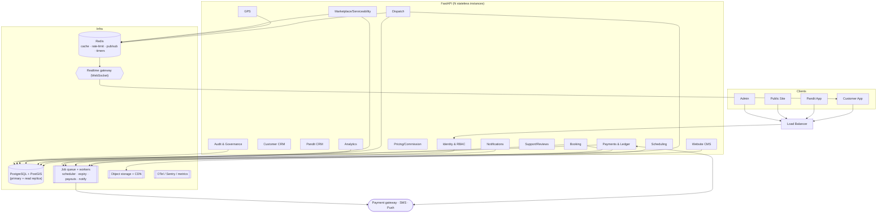

# 14 — Target Architecture

**Guiding principle:** evolve the existing **modular monolith**; do not rewrite, do not split into microservices without measured need. The current FastAPI app is already modular and mostly stateless — the target is the same shape with production infrastructure added and in-process state externalized.

## Technology evaluation (proposed vs existing)
| Area | Proposed | Existing | Verdict |
|---|---|---|---|
| Customer app | React Native + Expo + TS | **Same** | ✅ Keep. |
| Pandit app | React Native + Expo + TS | **Same** | ✅ Keep. |
| Admin | Next.js + TS | **Same** | ✅ Keep (already redesigned). |
| Backend | Modular TS app | **Python/FastAPI** | ⚠️ **Keep FastAPI.** The backend is already modular, typed (pydantic), migration-backed, and battle-tested in this codebase. Rewriting to TS discards working booking/dispatch/finance logic and tests for no measured benefit. Recommend **against** the TS rewrite; standardize on FastAPI. |
| Database | PostgreSQL | SQLite dev (PG wired) | ✅ Adopt Postgres (driver already normalized; enable psycopg). |
| Geo | PostGIS | haversine floats | ✅ Adopt for city-scale matching. |
| Cache | Redis | none | ✅ Adopt (rate limit, cache, dispatch timers, pub/sub). |
| Jobs | Durable queue | none | ✅ Adopt (arq/RQ/Celery) — needed for scheduler/expiry/payouts/notifications. |
| Realtime | WebSocket / managed | polling | ✅ Adopt for active-booking tracking. |
| Storage | Private object storage | local disk | ✅ Adopt (S3/GCS) + CDN. |
| Observability | OpenTelemetry | minimal logging | ✅ Adopt (OTel + Sentry + metrics). |

**Net:** the only divergence from the proposed stack is the backend language — keep **FastAPI**, not a TS backend, on the evidence that the existing Python backend is sound and feature-complete.

## Target diagram (modular monolith + infra)

## Required target modules (all under one deployable app)
Identity & RBAC · Customer CRM · Pandit CRM · Website CMS · Marketplace · Serviceability · Booking engine · Dispatch engine · Scheduling engine · Pricing & commission · Payment & financial ledger · GPS tracking · Notifications · Support & reviews · Analytics · Audit & governance. Most exist as modules today (`app/marketplace/*`, `app/api/*`); the net-new ones are **Scheduling**, **Notifications delivery**, **Analytics depth**, and the **Governance** surface.

## Module boundaries (within the monolith)
Keep today's package structure; enforce boundaries by domain packages with explicit service interfaces (no cross-module DB writes except via a domain's own service). Extract a service out of the monolith **only** when a specific module shows measured scaling/reliability/isolation needs (candidates, if ever: GPS ingestion, notifications fan-out) — not pre-emptively.

## Non-goals (avoid over-engineering)
Microservices, event-sourcing, multi-region, Kubernetes, a separate analytics warehouse — none are justified at launch. Introduce each only against measured need documented in `18_OPEN_DECISIONS.md`.
