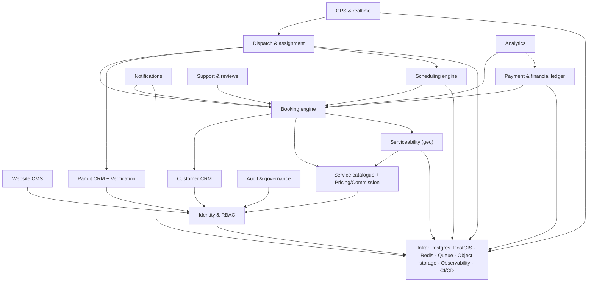

# 15 — Module Dependency Map

Dependency order for safe, incremental delivery. An arrow A → B means **A depends on B** (B must exist/stabilize first).

## Critical-path chain
`Infra → Identity/RBAC → {Catalogue, CRM} → Serviceability → Booking → {Scheduling, Dispatch} → {GPS, Payment} → {Notifications, Support, Analytics} → Governance.`

## Key coupling notes
- **Infra is the universal prerequisite** for the scale/correctness work: Postgres unblocks atomic locking; Redis+Queue unblock Scheduling, real expiry, Notifications, and realtime GPS.
- **Dispatch depends on Scheduling** to make scheduled bookings real (today Dispatch exists but Scheduling doesn't, which is why scheduled bookings are dead).
- **Payment depends on Booking state** and must be coupled to it (cancellation→refund) — fix the invariant when touching either.
- **Analytics depends on Booking + Payment** data shapes — build last to avoid rework.
- **Most modules already exist**; the map is primarily a *hardening/completion* order, not a greenfield build order.
